<p align="center">
  
</p>

<h1 align="center">Boubou</h1>

<p align="center">
  <strong>A command-line tool for talking with AI out loud.</strong><br />
  Open models run on your machine. Speak, pause for a reply, and interrupt whenever you like.
</p>

<p align="center">
  <a href="https://runboubou.com/"></a>
  <a href="https://discord.gg/SPz5v4Qf86"></a>
  <a href="https://x.com/RunBoubou"></a>
</p>

<p align="center">
  Apple Silicon · Linux · <a href="LICENSE">MIT licensed code</a>
</p>

<p align="center">
  
</p>

<p align="center">
  
</p>

<p align="center">
  <sub>Current source build on macOS. Illustrative conversation; setup time condensed. <a href="https://github.com/runboubou/boubou/issues/5">Release progress</a>.</sub>
</p>

## Quick start

Apple Silicon Mac, macOS 13.3+ and Node.js 18+:

```sh
npx boubou@beta run LFM3-Audio-2B
```

Allow microphone access. The first run downloads about **1.4 GB**. Then speak English.

<kbd>Esc</kbd> pause · <kbd>Enter</kbd> resume · <kbd>Ctrl+C</kbd> quit

The guided picker shown above is available in the current macOS source build.

<details>
<summary>Build from source / Linux</summary>

You need Rust 1.91+ and Xcode Command Line Tools on macOS. On Linux, install a C compiler, `pkg-config` and ALSA development headers.

```sh
git clone https://github.com/runboubou/boubou.git
cd boubou
cargo build --locked --release
./target/release/boubou run LFM3-Audio-2B
```

On macOS, run `./target/release/boubou` to open the picker shown above. Liquid models also support x86-64 and arm64 Linux with glibc 2.38+, OpenSSL 3 and `libgomp`. The picker currently requires macOS.

</details>

<details>
<summary>More commands, phones and browsers</summary>

```sh
boubou list
boubou pull LFM3-Omni-2B
boubou run LFM3-Omni-2B --offline
boubou doctor LFM3-Omni-2B
boubou ask LFM3-Omni-2B photo.png "What is in this picture?"
npx boubou@beta serve LFM3-Audio-2B
npx boubou@beta serve LFM3-Omni-2B
```

`serve` prints a browser link and a QR code for a phone on the same Wi-Fi. Allow microphone access and talk; one client can use the conversation at a time. Keep the printed link private: it contains the access key. Use `--local` to listen only on this computer.

Browser audio travels between the device and this computer over HTTPS; model inference stays on the host. By default, `serve` requests a trusted certificate from `lan.runboubou.com`; the name includes the host's local IP address. Its private key stays on the host. `--local`, `--self-signed` or `--offline` avoids that service. The self-signed fallback requires trusting its certificate in the browser.

Modular models also expose OpenAI-compatible Realtime and speech endpoints through `serve`. Prefer the printed HTTPS/WSS address; the HTTP/WS fallback is unencrypted.

Use `boubou --help` or `boubou <command> --help` for options. Models and runtimes are cached in `~/Library/Caches/boubou` on macOS or `~/.cache/boubou` on Linux; set `BOUBOU_HOME` to choose another folder.

</details>

## How it works

Rust connects your microphone and speakers to a local model server, with echo cancellation and speech detection.

- **One audio model:** Liquid models hear, think and speak through llama.cpp.
- **A modular pipeline:** speech recognition → Qwen → your choice of voice. See [models and runtimes](packaging/qwen/README.md).

**Inference runs on your machine.** No account, cloud model API key or telemetry. With `run`, audio stays on this computer. After downloading the models, use `--offline` to run without a network.

## Contributors

Built in the open. Thanks to everyone helping Boubou find its voice.

<a href="https://github.com/runboubou/boubou/graphs/contributors">
  
</a>

[All contributors](https://github.com/runboubou/boubou/graphs/contributors) · [Contribute to Boubou](CONTRIBUTING.md) · [Report a security issue](SECURITY.md)

---

[MIT](LICENSE).
